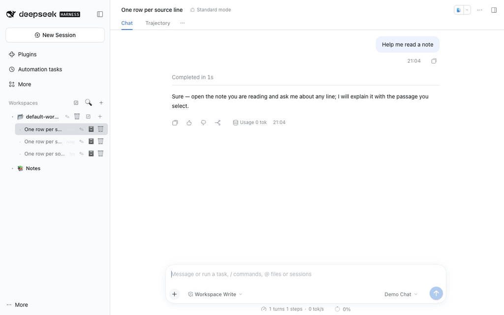

# Obsidian Notes for DeepSeek Harness

**A local Obsidian-style notes pane for the [DeepSeek Harness](https://github.com/deepseek-ai/deepseek-harness) web UI.** Point it at a folder of Markdown files, then read, edit, search and cite them next to the conversation — without opening Obsidian, without importing anything, and without your notes leaving the machine.



[](https://github.com/revive123456/dsh-obsidian-notes/actions/workflows/ci.yml)
[](https://github.com/revive123456/dsh-obsidian-notes/blob/main/LICENSE)

[](https://dshbase.com/zh/plugins/dsh-obsidian-notes/)
[](https://github.com/revive123456/dsh-obsidian-notes/stargazers)

English | [中文](https://github.com/revive123456/dsh-obsidian-notes/blob/main/README.zh.md)

---

## What it does

A local-first Markdown notes panel that sits in the DSH sidebar and hands notes
to the chat without copy-paste:

1. **Your notes stay beside the conversation.** Point it at a folder of Markdown
   files and you get the vault tree, an Obsidian-flavoured preview, edit/save,
   and search across titles and bodies — no import, no sync, no cloud.
2. **The handoff is the feature.** Cite a whole note as an `@path` mention, or
   select a passage and press **Ask** — the prompt in the composer carries the
   absolute path, the line range and the quoted text, so the model can refer to
   exactly what you read.
3. **Screenshots become part of the vault.** Paste an image while editing and it
   is saved into the attachment folder as an Obsidian-native
   `![[Pasted image …]]` embed; moving that folder later rewrites the embeds.
4. **Two ways to see the shape of a vault.** Turn a note into a **mind map**
   built from its headings and list items, or open the **relation graph**
   computed from `[[links]]` and `#tags` — vault-wide, locally around the open
   note with 1–5 hops, or focused: the whole graph with the camera framed on the
   open note and its neighbours.

Everything runs on your machine: the plugin reads and writes only the folder you
choose, and the client talks to the host over its own loopback routes.


## Install

**Requirements:** DeepSeek Harness **0.2.1 or newer** (web UI or desktop app).
The CLI install also needs **pnpm** (`npm i -g pnpm`, or `corepack enable`) and a
Node.js **`^22.19 || >=24`** runtime for DSH.

A plugin that ships a bundle layer is only composed at startup, so **restart the
DSH host after installing** (desktop: quit and reopen). Refreshing the page is
not enough.

### Already installed? Upgrading

Replacing the package and refreshing the page is enough for new UI features: the
client asks the host which capabilities it has (`/obsidian/root` → `features`)
and, when the running host is still the previous version, builds data it needs
from the existing routes instead of erroring. The relation graph, for example,
falls back to walking the vault with the old tree/note endpoints — no restart
and no "version mismatch" dialog. Restart the host when you want the faster
host-side route.

### 1. Desktop app (after the npm release)

1. Open **Settings → Plugins**.
2. Search for **`dsh-obsidian-notes`** and install it.
3. Restart DeepSeek Harness.

> This path requires the package to be published on npm.
> If search shows nothing, use one of the two paths below.

### 2. CLI (after the npm release)

```bash
npm i -g pnpm                                   # `dsh plugin` forwards to pnpm
dsh plugin --profile web add dsh-obsidian-notes
# restart the host, then start it again
dsh web
```

### 3. From source (works before the npm release)

```bash
git clone https://github.com/revive123456/dsh-obsidian-notes.git
cd dsh-obsidian-notes
npm i                     # runs build.mjs via prepare → lib/client.js
dsh plugin --profile web add "$(pwd)"            # PowerShell: "$PWD"
# restart `dsh web`
```

`dsh plugin add` records the package as a bundle in
`$DSH_HOME/profiles/web/package.json`; the profile patch is applied on the next
boot.

> Avoid installing this repository with a bare `github:` spec: pnpm ≥ 10 blocks
> lifecycle (`prepare`) scripts by default, so the build step that produces
> `lib/client.js` would be skipped. Clone + `npm i` + install the local path
> instead.

**Uninstall:** `dsh plugin --profile web remove dsh-obsidian-notes`, then restart.
If you installed it the old way (manual `cordis.patch.yml` row), see
[docs/legacy-install.md](https://github.com/revive123456/dsh-obsidian-notes/blob/main/docs/legacy-install.md).

### First run

Open the **📚 Notes** row at the bottom of the sidebar. If no vault is
configured, choose one:

- **📂** opens a directory picker;
- **📋** accepts a pasted absolute path.

The default vault is `$DSH_WORKSPACE/obsidian_vault`, falling back to
`./obsidian_vault` under the directory you started `dsh web` from.

### Typical workflow

1. Open **📚 Notes** and pick a vault (above).
2. Click a note to read the preview; **Edit** to change it, then **Save** or
   <kbd>Ctrl/Cmd+S</kbd>.
3. To bring a note into the chat, press **⤴ Cite to chat** for the whole note, or
   select text and press **Ask** to attach a question to that passage.
4. Paste a screenshot while editing to store it in the vault.
5. Switch the dock to **🧠 Mind map** to explore the note's structure, or open
   **🕸 Graph view** above the tree to see the vault as a graph (**Local** = around
   the open note, **Depth 1–5**; **Focus** = whole graph, camera on the open note).

## Features

- **Vault sidebar** — lazy directory tree; open a note with one click, create,
  rename or delete notes and folders, and search titles **and** file contents.
  Shows a live note count.
- **Obsidian-style preview** — every source line renders as its own row, so
  tables, fenced code, nested lists and callouts line up the way they do in
  Obsidian. Line numbers stay out of the reading view and show only while you
  edit. Real tables with alignment, fenced code with language labels, nested
  lists and task lists, all heading levels, setext headings, horizontal rules,
  and clickable `[[wikilinks]]` (aliases and `#sections` included). Inline
  Obsidian styles render too: `==highlight==`, `~~strikethrough~~`, backslash
  escapes, hidden `%%comments%%`, and `<https://…>` / bare URLs as links.
- **Graph view** — a vault-wide relation graph built from every note's `[[links]]`
  and `#tags` (no graph file, no export step: it is computed from your Markdown on
  the fly, like Obsidian's own graph). A vault-level entry above the note tree
  opens it as its own view; scroll to zoom, drag to pan, hover to highlight
  neighbours, click a note to open it in the dock. **Local** shows the
  neighbourhood of the note that is currently open; the depth is adjustable
  from 1 to 5 hops (same range as Obsidian's local graph depth slider, default
  1). **Focus** keeps the whole graph but frames the open note and its
  neighbours — click it again to re-centre.
- **Mind map view** — toggle the preview into a horizontal mind map built from the
  note's headings and list items. Scroll to zoom, drag to pan; select a node to
  jump to its source line, or insert that whole branch (node + descendants) into
  the chat as context. Rendering only — the Markdown file is untouched.
- **Callouts** — `> [!type] title` blocks render with type colours, icons and
  badges. 13 canonical types (`note`, `abstract`, `info`, `todo`, `tip`,
  `success`, `question`, `warning`, `failure`, `danger`, `bug`, `example`,
  `quote`) plus 15 Obsidian aliases (`summary`, `tldr`, `hint`, `important`,
  `check`, `done`, `help`, `faq`, `caution`, `attention`, `fail`, `missing`,
  `error`, `cite`, `none`).
- **Edit and save** — line-numbered source editor, save with the button or
  <kbd>Ctrl/Cmd+S</kbd>. The YAML frontmatter is never shown in the editor and is
  stitched back untouched on save; external edits to the YAML are preserved.
- **Screenshot paste** — <kbd>Ctrl/Cmd+V</kbd> in the editor uploads the image to
  the configured attachment folder and inserts the Obsidian-native
  `![[Pasted image <timestamp>.png]]` embed (20 MB per image). Files written this
  way keep working in real Obsidian.
- **Attachment folder management** — four location modes (Vault root, fixed
  folder, same folder as the note, subfolder under the note), image-only folders
  hidden from the tree, and optional orphan cleanup. Changing the folder moves
  existing screenshots and rewrites the embeds in every note.
- **Cite and ask** — `⤴ Cite to chat` inserts `@/abs/path/to/note.md` into the
  composer (falling back to the clipboard if the composer cannot be reached).
  Select text in the preview or editor to get the **💬 Ask / ⚡ Explain** bar: the
  prompt contains the absolute path, the line range, the quoted passage (up to
  1500 characters) and your question.
- **Session and workspace housekeeping** — rename, archive or permanently delete
  sessions from the sidebar; batch-select sessions (archive/delete) or
  workspaces (delete registration and their session logs); rows whose logs are
  already gone are hidden instead of resurrected. Running sessions are refused,
  and deleting a workspace never touches its directory or files.
- **Docked panel** — the preview panel can be dragged around and resized; the
  width you pick is remembered. The preview polls the file's mtime and refreshes
  when the file changes on disk.

The UI is bilingual (English / Chinese) and uses DSH theme tokens, so it follows
the app's light and dark themes.

## Configuration

Everything lives inside the notes pane; there is no YAML to edit.

### Vault root

`📂` (pick a directory) or `📋` (paste an absolute path) in the notes toolbar.
The picker and the pasted path are validated: the vault must exist and be a
directory. Switching the vault clears the currently open note.

### Attachments

The `📎 Attachment location` row in the tree controls where pasted images go:

| Mode | Behaviour |
| --- | --- |
| Vault root | The image lands in the vault root. |
| Fixed folder | The image lands in the configured folder (default `attachments`). |
| Same folder as note | The image lands next to the note it was pasted into. |
| Subfolder under note | The image lands in `<note dir>/<subfolder>`. |

Defaults: fixed folder `attachments`, image-only folders hidden from the tree,
automatic orphan deletion **off** (files are never deleted implicitly). When
automatic cleanup is enabled, saving a note deletes an attachment only if the
embed was removed **and** no other note references the file.

Settings are persisted in `$DSH_HOME/dsh-obsidian-vault.json`
(`$DSH_HOME` defaults to `~/.dsh`).

### Keyboard

- <kbd>Ctrl/Cmd+S</kbd> — save the note being edited.
- <kbd>Esc</kbd> — close the search box or the ask popup.

## Security and privacy

- **Local only, no telemetry.** The plugin serves everything from the DSH host's
  own `/obsidian/*` routes. It makes no outbound network requests and contains
  no analytics. (Links you click in a note are ordinary links; the plugin does
  not fetch them.)
- **Behind the DSH auth fence.** The routes are mounted on the DSH web server, so
  they require the same authenticated session/token as the app. On top of that,
  every non-image request must carry the plugin's `x-dsh-obsidian: 1` header;
  image requests are exempt only because `` tags cannot set headers (they
  are still behind the app's auth).
- **Vault containment.** Every path that crosses the route boundary is
  normalized first (absolute paths, `..`, backslashes and drive letters are
  rejected) and then re-checked with `realpath` against the resolved vault root,
  so symlinks cannot escape either. Setting the attachment folder outside the
  vault is rejected with `403`.
- **Explicit limits.** A single note is capped at 1 MB, a pasted image at
  20 MB, and a search at 4000 scanned files / 100 results.
- **Destructive actions are scoped.**
  - Deleting a note or folder requires confirmation and deletes only the vault
    entry (folders recursively).
  - Deleting sessions removes only that session's log directory under
    `$DSH_HOME/sessions` and its projection cache under `$DSH_HOME/storages`;
    running sessions (including running subagents) are refused, and symlinked
    directories are skipped. Archiving is one-way: the log stays on disk.
  - Deleting a workspace removes its registration and its session logs — the
    directory and files are kept.
- **No hidden writes.** The only write paths are: a note save, the attachment
  upload, attachment folder migration, orphan cleanup (opt-in), and session-log
  deletion you initiated.

## Compatibility

- **DSH:** verified against **0.2.1-rc.5** (web UI, desktop app shell). The
  composer integration targets DSH 0.2's Lexical input and falls back to the
  0.1.x textarea path where possible.
- **Node.js:** `^22.19 || >=24` (needed only when running the host from source).
- **OS:** paths are handled with the platform separator; session paths use
  `$DSH_HOME`. The GIF above was recorded on macOS.
- **Not rendered** (kept as source text): math, mermaid, footnotes, tags, raw
  HTML, note transclusion, audio/PDF embeds, block refs (`^id`), callout
  folding/unknown types/nested callouts, and some inline emphasis edge cases
  (`***bold italic***`, nested emphasis, `_` next to text).

## Development

```bash
npm i             # installs dev deps and builds lib/client.js via prepare
npm test          # node --test test/*.mjs — offline, no network, no API keys
npm run build     # rebuild lib/client.js from src/
npm run check:bundle   # bundle manifest consistency (patch file, module id, files)
```

Repository layout:

| Path | Purpose |
| --- | --- |
| `src/index.js` | Host half: `/obsidian/*` routes, path containment, attachment migration |
| `src/client.js` | Browser half: sidebar, notes tree, preview dock, session/workspace UI |
| `src/markdown.js` | Zero-dependency Markdown renderer (one row per source line) |
| `src/vault-store.js` | Vault + attachment settings persistence |
| `src/session-store.js` | Session log discovery and deletion |
| `lib/client.js` | Build artifact (gitignored; produced by `npm run build`) |
| `cordis.patch.yml` | The bundle layer inserted by `dsh plugin add` |
| `tools/demo/` | Isolated demo environment + headless-Chrome asset pipeline (see [tools/demo/README.md](https://github.com/revive123456/dsh-obsidian-notes/blob/main/tools/demo/README.md)) |
| `docs/assets/` | The GIF (and the screenshots used by the plugin listings) |

The plugin never modifies the DSH installation: it only contributes a bundle
layer plus host/client plugin modules.

Contributions are welcome through pull requests — `main` is protected and only
the maintainer can push to it. See [CONTRIBUTING.md](CONTRIBUTING.md).

## License

[MIT](https://github.com/revive123456/dsh-obsidian-notes/blob/main/LICENSE). See [README.zh.md](https://github.com/revive123456/dsh-obsidian-notes/blob/main/README.zh.md) for the Chinese version and
[docs/troubleshooting.md](https://github.com/revive123456/dsh-obsidian-notes/blob/main/docs/troubleshooting.md) for troubleshooting.
