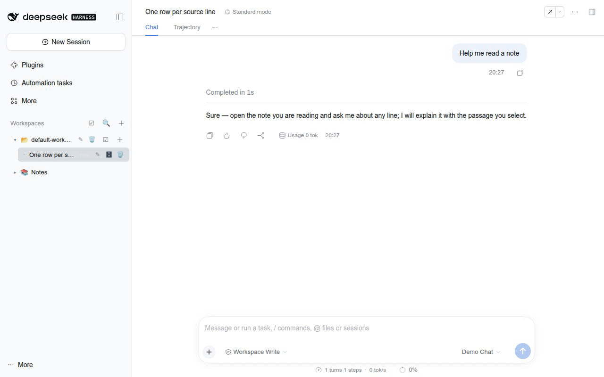
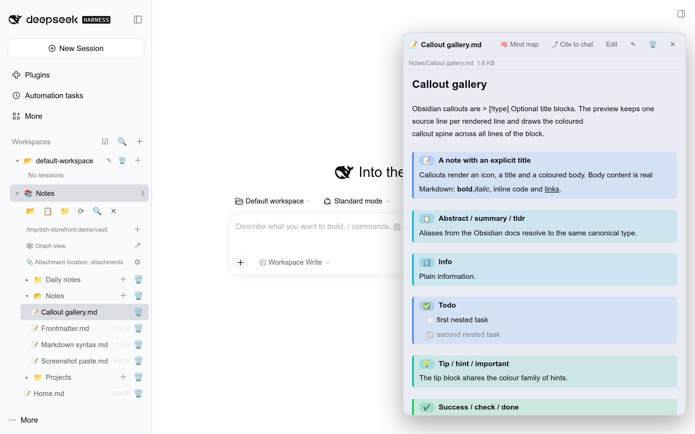
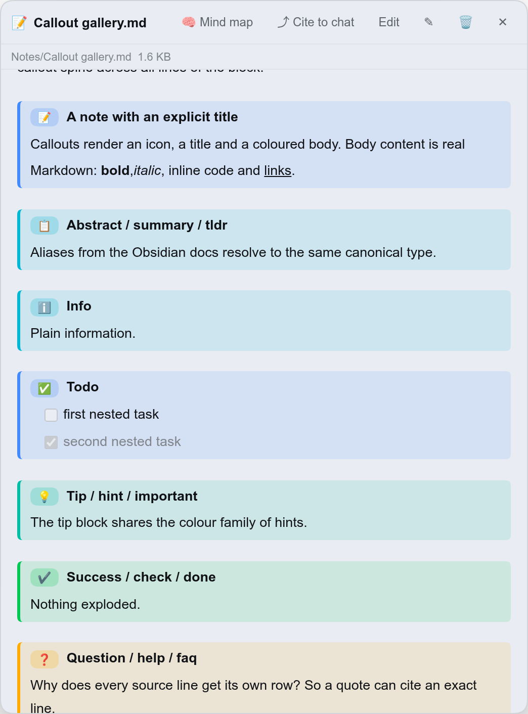
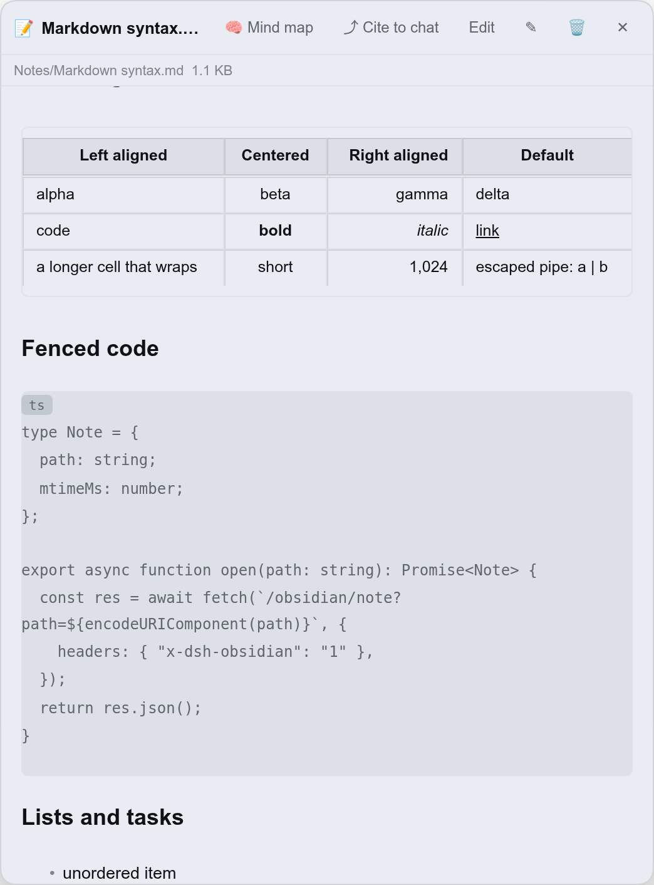
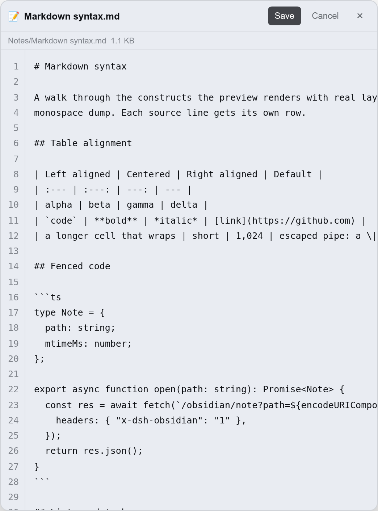
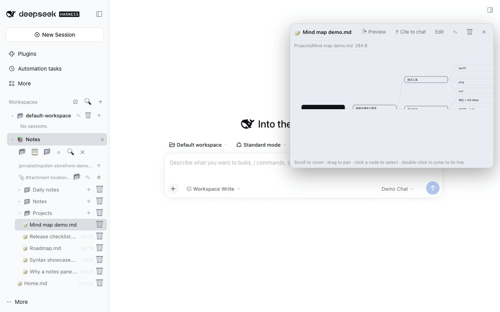
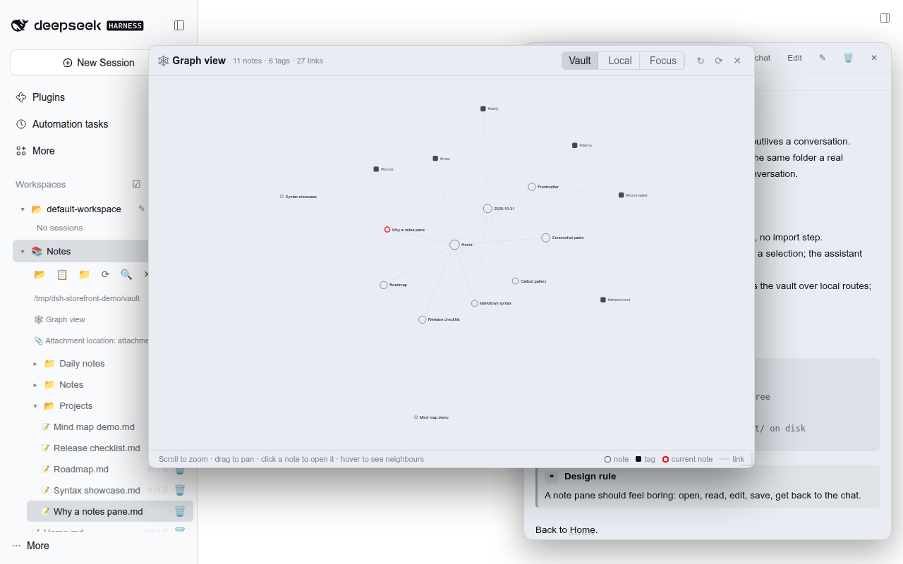
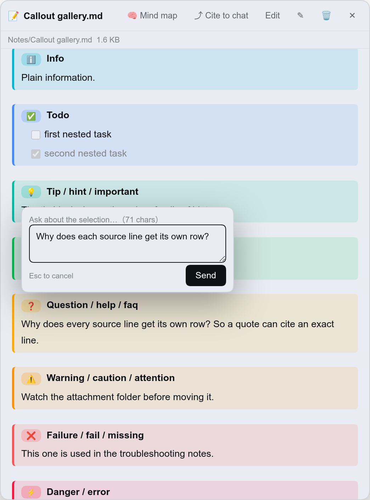

# Obsidian Notes for DeepSeek Harness

**DeepSeek Harness Web 的本地 Obsidian 风格笔记面板。** 指向一个 Markdown 文件夹，就能在对话旁边浏览、编辑、搜索、引用笔记 —— 不用装 Obsidian、不用导入，笔记也不会离开这台机器。



[](https://github.com/revive123456/dsh-obsidian-notes/actions/workflows/ci.yml)
[](https://github.com/revive123456/dsh-obsidian-notes/blob/main/LICENSE)

[](https://dshbase.com/zh/plugins/dsh-obsidian-notes/)
[](https://github.com/revive123456/dsh-obsidian-notes/stargazers)

[English](https://github.com/revive123456/dsh-obsidian-notes/blob/main/README.md) | 中文

---

## 它能做什么

一个本地优先的 Markdown 笔记面板：在 DSH 侧边栏里读笔记，并把笔记顺手递进对话，不用复制粘贴。

1. **笔记就在对话旁边。** 指向一个 Markdown 文件夹，就有目录树、带行号的 Obsidian 风格预览、编辑保存，以及标题和正文搜索——不导入、不同步、不上云。
2. **「递进对话」本身就是功能。** 整篇引用为 `@绝对路径`；选中一段点 **Ask**，输入框里的 prompt 带着绝对路径、行号区间和原文，模型能准确引用你正在看的这一段。
3. **截图直接进笔记库。** 编辑时粘贴图片会存进附件目录，并写成 Obsidian 原生的 `![[Pasted image …]]`；以后迁移附件目录，全库引用会一起改写。
4. **两种看结构的方式。** 把笔记切换成由标题和列表生成的**思维导图**；或打开由 `[[双链]]` 和 `#标签` 现算的**关系图谱**——全库视角，或聚焦当前笔记的 1–5 跳局部视角。

全部在本机运行：插件只读写你选择的文件夹，客户端只走宿主自己的 loopback 路由。

## 截图

| 侧边栏笔记树 + 右侧预览 | Callout、行号、类型徽标 |
| --- | --- |
|  |  |

| 真表格与围栏代码 | 带行号的源码编辑视图 |
| --- | --- |
|  |  |

| 由标题 + 列表生成的思维导图 | 全库关系图谱（笔记、双链、标签） |
| --- | --- |
|  |  |



## 安装

**前置要求：** DeepSeek Harness **0.2.1 或更新**（Web UI / 桌面版）。CLI 安装还需要 **pnpm**（`npm i -g pnpm` 或 `corepack enable`）；从源码跑需要 Node.js **`^22.19 || >=24`**。

带 bundle 的插件只在启动时装配，所以**安装后必须重启 DSH host**（桌面版：退出再打开）。只刷新页面不够。

### 已经装过？升级说明

换掉包、刷新页面就能用上新界面能力：客户端会先问 host 支持哪些能力（`/obsidian/root` → `features`），如果运行中的 host 还是旧版，就用**已有接口在浏览器里自建**需要的数据，而不是弹「版本不匹配」错误。比如关系图谱在旧 host 上会回退成用旧的 tree/note 接口遍历 vault 构建——不用重启、也不会看到报错。想要更快的 host 侧路径时再重启一次即可。

### 1. 桌面版（npm 发布后）

1. 打开 **Settings → Plugins**；
2. 搜索 **`dsh-obsidian-notes`** 并安装；
3. 重启 DeepSeek Harness。

> 这条路径要求 npm 上已有该包（当前版本 **0.6.0**）。搜不到时用下面两种方式。

### 2. CLI（npm 发布后）

```bash
npm i -g pnpm                                   # `dsh plugin` 会转发给 pnpm
dsh plugin --profile web add dsh-obsidian-notes
# 重启 host 后再启动
dsh web
```

### 3. 从源码安装（npm 发布前也能用）

```bash
git clone https://github.com/revive123456/dsh-obsidian-notes.git
cd dsh-obsidian-notes
npm i                     # 通过 prepare 跑 build.mjs → 生成 lib/client.js
dsh plugin --profile web add "$(pwd)"            # PowerShell 用 "$PWD"
# 重启 `dsh web`
```

`dsh plugin add` 会把这个包记为 profile 的 bundle，写进
`$DSH_HOME/profiles/web/package.json`，下次启动时生效。

> 不建议直接用 `github:` 形式安装本仓库：pnpm ≥ 10 默认拦截生命周期
> (`prepare`) 脚本，生成 `lib/client.js` 的构建步骤会被跳过。请用
> clone + `npm i` + 安装本地路径。

**卸载：** `dsh plugin --profile web remove dsh-obsidian-notes`，然后重启。若当年是手工改
`cordis.patch.yml` 装的，见 [docs/legacy-install.md](https://github.com/revive123456/dsh-obsidian-notes/blob/main/docs/legacy-install.md)。

### 首次使用

点侧边栏底部的 **📚 笔记**。没有配置 Vault 时先选目录：

- **📂** 打开目录选择器；
- **📋** 接受一个粘贴的绝对路径。

默认 Vault 为 `$DSH_WORKSPACE/obsidian_vault`，缺省回落到启动 `dsh web` 目录下的
`./obsidian_vault`。

### 典型用法

1. 打开 **📚 笔记**，先选一个 Vault（见上）。
2. 点击笔记读带行号的预览；点 **编辑** 修改，再点 **保存** 或 <kbd>Ctrl/Cmd+S</kbd>。
3. 把笔记带进对话：整篇点 **⤴ 引用到对话**；选中一段点 **Ask**，把问题附着在那段文字上。
4. 编辑时粘贴截图，会存进 Vault 的附件目录。
5. 把 Dock 切成 **🧠 思维导图** 看笔记结构；或点笔记树上方的 **🕸 关系图谱** 看全库图（**局部** = 当前笔记周围，**跳数 1–5**）。

## 功能

- **Vault 侧边栏**：按需加载的目录树；单击打开笔记，新建 / 重命名 / 删除笔记与文件夹，按标题**和正文**搜索，显示笔记数徽标。
- **带行号的 Obsidian 预览**：一行源码对应一行渲染并带行号。真表格（支持 `:---` / `:---:` / `---:` 对齐）、带语言标签的围栏代码、嵌套列表与任务列表、`#`～`######` 标题、setext 标题、分隔线、可点击的 `[[双链]]`（含别名与 `#章节`）；行内也支持 `==高亮==`、`~~删除线~~`、反斜杠转义、隐藏的 `%%注释%%`，以及 `<https://…>` / 裸 URL 自动成链。
- **关系图谱**：全库关系图，节点/连线直接由每篇笔记的 `[[双链]]` 与 `#标签` 现算（没有额外图谱文件，也不导出——和 Obsidian 自己的图谱一样从 Markdown 推导）。入口在笔记树上方的 vault 级「🕸 关系图谱」行，点击后在独立视图里显示；滚轮缩放、拖动平移、悬停高亮邻居、点笔记节点在 Dock 里打开。切到「局部」可看当前打开笔记的邻居，跳数可在 1–5 之间调（与 Obsidian 局部图谱的 depth 范围一致，默认 1）；「聚焦当前笔记」可从全库一键切到该视角。
- **思维导图视图**：把预览切换成由标题 + 列表生成的横向思维导图。滚轮缩放、拖动平移；选中节点可跳到对应源码行，或把「该分支（节点 + 全部后代）」作为上下文插入对话。纯渲染，不改动 Markdown 文件。
- **Callout**：`> [!type] 标题` 按类型渲染颜色、图标与徽标。13 种规范类型（`note`、`abstract`、`info`、`todo`、`tip`、`success`、`question`、`warning`、`failure`、`danger`、`bug`、`example`、`quote`）+ 15 个 Obsidian 别名（`summary`、`tldr`、`hint`、`important`、`check`、`done`、`help`、`faq`、`caution`、`attention`、`fail`、`missing`、`error`、`cite`、`none`）。
- **编辑与保存**：带行号的源码编辑器，点 `保存` 或按 <kbd>Ctrl/Cmd+S</kbd>。YAML frontmatter 不进编辑器，保存时原样拼回；外部对 YAML 的改动不会被覆盖。
- **粘贴截图**：编辑时 <kbd>Ctrl/Cmd+V</kbd> 把剪贴板图片写入附件目录，并在光标处插入 Obsidian 原生写法 `![[Pasted image <时间戳>.png]]`（单张上限 20 MB），写进 `.md` 的内容可被真实 Obsidian 识别。
- **附件目录管理**：四种位置模式（Vault 根 / 固定目录 / 与笔记同目录 / 笔记目录下子目录）、目录树隐藏纯图片目录、可选孤儿附件清理。修改目录会移动已有截图并改写全库笔记引用。
- **引用与提问**：`⤴ 引用到对话` 把 `@绝对路径` 注入输入框（注入不了时复制到剪贴板）；在预览或编辑器中选中文字会出现 **💬 提问 / ⚡ 解释** 浮动条，注入内容包含绝对路径、行号区间、原文（≤1500 字符）和你的问题。
- **会话与工作区整理**：重命名 / 归档 / 彻底删除会话；批量勾选会话（归档、彻底删除）或工作区（删除注册项及其会话日志）；日志已不存在的行会被隐藏而不是复活。运行中的会话拒绝删除；删除工作区不碰目录和文件。
- **可停靠面板**：预览面板可拖动、可调宽，宽度会被记住；预览每 3 秒探测文件 mtime，磁盘上的改动会自动刷新。

界面中英双语，使用 DSH 主题变量，跟随应用的浅色 / 深色主题。

## 配置

所有配置都在笔记面板里完成，不用手改 YAML。

### Vault 根目录

笔记工具栏的 `📂`（选目录）或 `📋`（粘贴绝对路径）。目录必须存在且是目录；切换 Vault 会清空当前打开的笔记。

### 附件

目录树里的 `📎 Attachment location` 行控制粘贴图片的落盘位置：

| 模式 | 行为 |
| --- | --- |
| Vault 根 | 图片落在 Vault 根目录。 |
| 固定目录 | 图片落在配置的目录（默认 `attachments`）。 |
| 与笔记同目录 | 图片落在被粘贴笔记所在目录。 |
| 笔记目录下子目录 | 图片落在 `<笔记目录>/<子目录>`。 |

默认值：固定目录 `attachments`、目录树隐藏纯图片目录、自动清理孤儿附件**关闭**（不会隐式删文件）。打开自动清理后，只有「这次保存移除了引用」且「没有其它笔记引用」的附件才会被删。

设置持久化在 `$DSH_HOME/dsh-obsidian-vault.json`（`$DSH_HOME` 缺省 `~/.dsh`）。

### 快捷键

- <kbd>Ctrl/Cmd+S</kbd>：保存正在编辑的笔记。
- <kbd>Esc</kbd>：关闭搜索框或提问浮层。

## 安全与隐私

- **纯本地、无遥测。** 所有能力都由 DSH host 自己的 `/obsidian/*` 路由提供；插件不发起任何外网请求，也不含统计埋点。（笔记里点链接是普通链接；插件不会去抓取。）
- **在 DSH 鉴权之后。** 路由挂在 DSH web server 上，需要和应用相同的已认证会话/token。除此之外，所有非图片请求还必须带插件自己的 `x-dsh-obsidian: 1` 头；图片请求豁免只因为 `` 无法带自定义头（它同样在应用鉴权之后）。
- **Vault 包含性校验。** 跨越路由边界的每个路径先做词法规范化（绝对路径、`..`、反斜杠、盘符一律拒绝），再用 `realpath` 对真实 Vault 根做一次包含性校验，符号链接也逃不出去。把附件目录设到 Vault 之外会被 `403` 拒绝。
- **明确的限额。** 单篇笔记上限 1 MB，粘贴图片上限 20 MB，搜索最多扫描 4000 个文件、返回 100 条。
- **破坏性操作有边界。**
  - 删除笔记/文件夹需确认，且只删 Vault 内的条目（文件夹递归）。
  - 删除会话只删该会话在 `$DSH_HOME/sessions` 下的日志目录与 `$DSH_HOME/storages` 下的投影缓存；运行中的会话（含运行中子代理）拒绝删除，符号链接目录一律跳过。归档是单向的：日志保留在磁盘。
  - 删除工作区 = 删注册项 + 该工作区的会话日志，目录和文件保留。
- **没有隐式写入。** 唯一的写路径是：保存笔记、上传附件、附件目录迁移、孤儿清理（需显式开启）、以及你主动发起的会话日志删除。

## 兼容性

- **DSH：** 已对照 **0.2.1-rc.5** 验证（Web UI、桌面版外壳）。composer 集成面向 DSH 0.2 的 Lexical 输入框，并保留 0.1.x textarea 的降级路径。
- **Node.js：** `^22.19 || >=24`（仅从源码运行 host 时需要）。
- **系统：** 路径按平台分隔符处理，会话路径基于 `$DSH_HOME`。上面的截图在 macOS 上录制。
- **不渲染（保持原文显示）**：数学公式、mermaid、脚注、标签、裸 HTML、笔记 transclusion、音频/PDF 嵌入、块引用 `^id`、callout 折叠/未知类型/嵌套，以及部分行内强调边界（`***粗斜体***`、嵌套强调、`_` 相邻文本）。

## 开发

```bash
npm i             # 安装 dev 依赖，并通过 prepare 构建 lib/client.js
npm test          # node --test test/*.mjs —— 离线、不联网、不需要 API Key
npm run build     # 从 src/ 重新构建 lib/client.js
npm run check:bundle   # bundle 清单一致性（patch 文件、module id、files）
```

仓库结构：

| 路径 | 作用 |
| --- | --- |
| `src/index.js` | host 半边：`/obsidian/*` 路由、路径包含性、附件迁移 |
| `src/client.js` | 浏览器半边：侧边栏、笔记树、预览 Dock、会话/工作区 UI |
| `src/markdown.js` | 零依赖、带行号的 Markdown 渲染器 |
| `src/vault-store.js` | Vault 与附件设置的持久化 |
| `src/session-store.js` | 会话日志发现与删除 |
| `lib/client.js` | 构建产物（gitignore；由 `npm run build` 生成） |
| `cordis.patch.yml` | `dsh plugin add` 安装后生效的 bundle 层 |
| `tools/demo/` | 隔离 demo 环境 + 无头 Chrome 资产生成流程（见 [tools/demo/README.md](https://github.com/revive123456/dsh-obsidian-notes/blob/main/tools/demo/README.md)） |
| `docs/assets/` | 上面用到的截图与 GIF |

插件不修改 DSH 安装本身：只贡献一个 bundle 层和 host/client 插件模块。

欢迎通过 PR 贡献 —— `main` 已开启分支保护，只有维护者能直接 push。见
[CONTRIBUTING.md](CONTRIBUTING.md)。

## 许可

[MIT](https://github.com/revive123456/dsh-obsidian-notes/blob/main/LICENSE)。英文版见 [README.md](https://github.com/revive123456/dsh-obsidian-notes/blob/main/README.md)，排障见
[docs/troubleshooting.zh.md](https://github.com/revive123456/dsh-obsidian-notes/blob/main/docs/troubleshooting.zh.md)。
